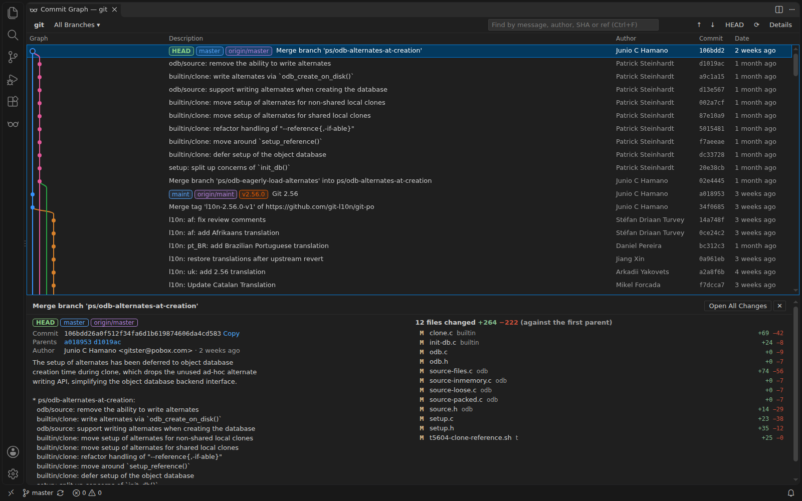
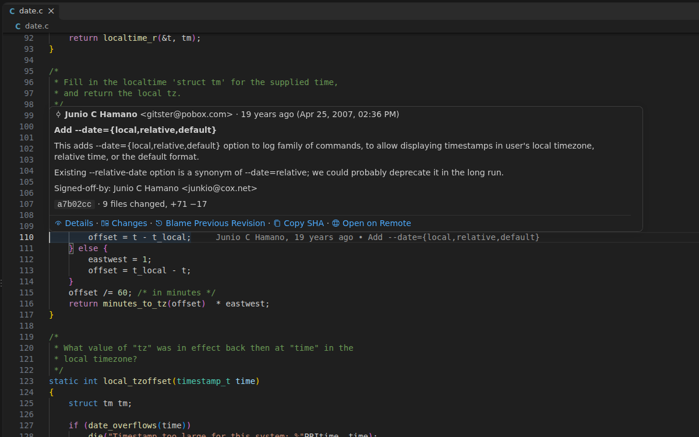
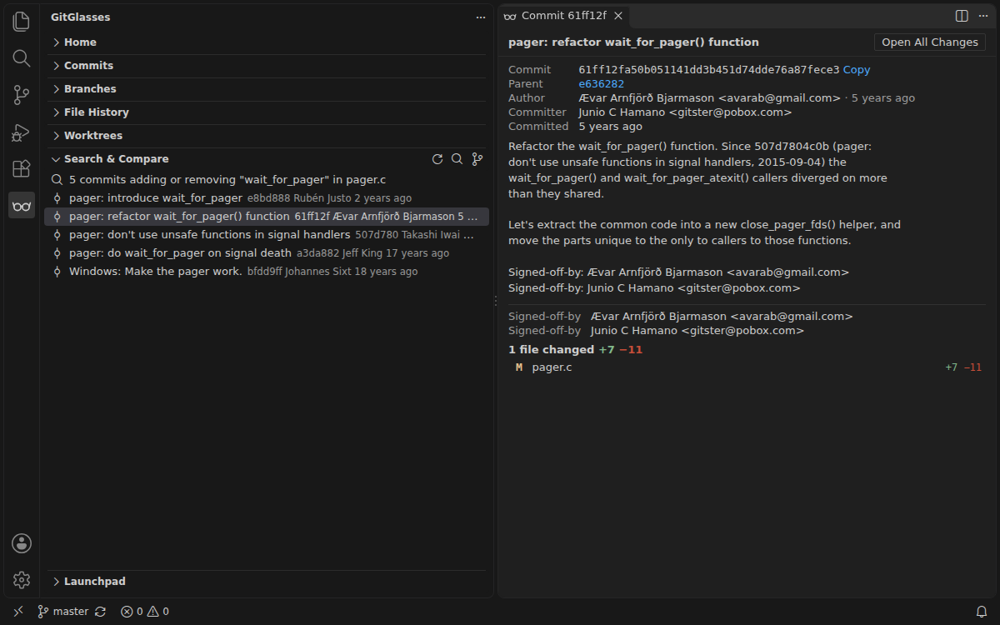
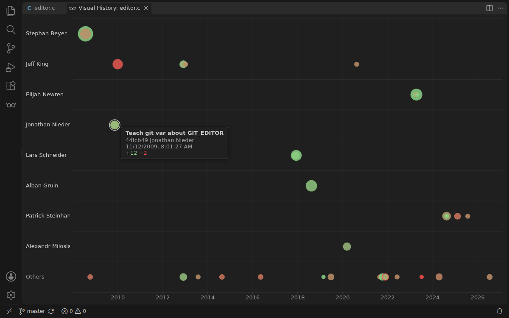
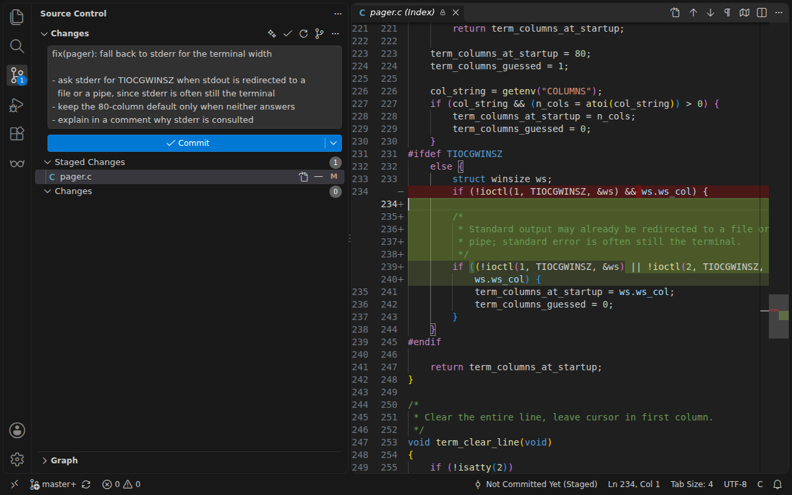

# GitGlasses

**The maintained, open git lens for VS Code and Open VSX: free on private
repos, no account, no telemetry.**



GitGlasses is an MIT-licensed git extension for VS Code and the editors that
install from [Open VSX](https://open-vsx.org): VSCodium, Cursor, Windsurf,
Theia, code-server and Gitpod. It brings inline blame, a Commit Graph, file
and line history, commit search by message, author, code change, file or
date, an interactive rebase editor, worktrees, and a pull request inbox, all
backed by a native engine. Every feature works on private repositories, with
no account and no telemetry.

| | |
| --- | --- |
|  |  |
|  |  |

## Install

- **VS Code:** [Visual Studio Marketplace](https://marketplace.visualstudio.com/items?itemName=gitglasses.gitglasses),
  or `code --install-extension gitglasses.gitglasses`.
- **VSCodium, Cursor, Windsurf, Theia, code-server, Gitpod:**
  [Open VSX](https://open-vsx.org/extension/gitglasses/gitglasses); search for
  GitGlasses in the Extensions view.
- **Offline:** each [GitHub release](https://github.com/danielwoz/gitglasses/releases)
  carries every `.vsix` with a `SHA256SUMS` file and build provenance
  attestations:

  ```sh
  gh attestation verify gitglasses-linux-x64-<version>.vsix --repo danielwoz/gitglasses
  code --install-extension gitglasses-linux-x64-<version>.vsix
  ```

The editor picks the package for its platform: Windows (x64, arm64), macOS
(Intel, Apple silicon), Linux (x64, arm64; glibc 2.28 or newer) and Alpine
Linux (x64, arm64) carry the native engine, and the `web` package runs a
read-only WebAssembly engine on vscode.dev for local folders with a `.git`
directory. Features that run git need `git` on `PATH`; 2.34 or newer is
recommended.

What the extension does, its settings and commands, and exactly when it uses
the network are in [its README](extension/README.md); what changed in each
release is in [the changelog](extension/CHANGELOG.md).

## Why GitGlasses

- **Nothing is held back:** no paid tier, no trial, no feature that stops at
  a private repository.
- **No account, no telemetry, no GitGlasses servers.** Integrations call your
  forge with your own token, kept in the editor's secret storage; AI goes to
  the provider you choose, after asking.
- **On both stores**, from the same release, so VSCodium and Cursor users get
  what VS Code users get.
- **Native engine.** Blame, history, the graph and search come from a C++
  engine that reads the repository in process with libgit2 and runs git
  where git is the authority (credentials, signing, rebase), apart from the
  editor so it cannot take the editor down.
- **Safe in untrusted folders:** in Restricted Mode no git runs at all.

## Layout

| Path | What |
|---|---|
| `engine/` | C++ analysis daemon, JSON-RPC over stdio |
| `packages/protocol/` | Wire protocol: TypeBox schemas → TS types + generated C++ |
| `extension/` | VS Code extension (thin TypeScript shim over the engine) |
| `mcp-server/` | MCP server over the engine; built and tested, but not shipped for now |
| `fixtures/` | Deterministic fixture-repo generators for tests |
| `docs/` | Specs, known limitations, clean-room policy, integrations |

## Building

There are two ways in: the TypeScript workspaces alone (extension, MCP server,
protocol and provider packages), using an engine that CI already built, or
everything including the C++ engine.

### Prerequisites

- Node.js 22 (22.13 or newer) or 24 and later, as pnpm 11 and ESLint require;
  `.nvmrc` selects 22.
- pnpm 11. `corepack enable` provides the version that `package.json` pins.
- git 2.32 or newer.
- For the engine: CMake 3.25 or newer, Ninja, a C++20 compiler (GCC 11+,
  Clang 14+, Xcode 15, or Visual Studio 2022), and a clone of
  [vcpkg](https://github.com/microsoft/vcpkg) with `VCPKG_ROOT` pointing at it
  and its bootstrap script run. The clone must contain the `builtin-baseline`
  commit from `vcpkg.json`; after that changes, `git pull` in it and bootstrap
  again.

### TypeScript only

```sh
pnpm install
pnpm build
pnpm fetch-engine   # the engine CI built from this checkout's engine sources
pnpm test
```

`pnpm fetch-engine` installs the engine into `build/release/engine/`, where the
extension, the tests, the e2e suite and the MCP server look for it. It only
uses a build of exactly the engine sources you have checked out, made by CI on
`main` for Linux x64, macOS arm64 or Windows x64 within the last 30 days.
GitHub serves those builds only to signed-in clients, so sign in with
`gh auth login` or set `GITHUB_TOKEN`. When no build matches (for example,
you changed `engine/`), build the engine as below. Without any engine,
`pnpm test` skips the two engine integration suites and runs everything else.

To try the extension, open the repository in VS Code and run the
**Run Extension** launch configuration (F5).

### The engine

The presets read the engine's dependencies from a directory outside the
build tree, so install them there first, from the repository root, and again
whenever `vcpkg.json` changes:

| Host | Install the dependencies | Presets |
|---|---|---|
| Linux x64 | `"$VCPKG_ROOT/vcpkg" install --triplet x64-linux --x-install-root="$HOME/.cache/gitglasses/vcpkg_installed"` | `debug`, `release`, `asan`, `tsan` |
| Linux arm64 | `"$VCPKG_ROOT/vcpkg" install --triplet arm64-linux --x-install-root="$HOME/.cache/gitglasses/vcpkg_installed"` | `linux-arm64-debug`, `linux-arm64-release` |
| macOS (Apple Silicon) | `"$VCPKG_ROOT/vcpkg" install --triplet arm64-osx-gg --overlay-triplets=ci/triplets --x-install-root="$HOME/.cache/gitglasses/vcpkg_installed"` | `macos-debug`, `macos-release` |
| Windows x64 | `& "$env:VCPKG_ROOT\vcpkg.exe" install --triplet x64-windows-static --x-install-root="$env:USERPROFILE\.cache\gitglasses\vcpkg_installed"` | `windows-debug`, `windows-release` |

On an Intel Mac, install `x64-osx-gg` instead and add
`-DVCPKG_TARGET_TRIPLET=x64-osx-gg` when configuring; on Windows arm64, the same
with `arm64-windows-static`. On Windows, run everything from a Developer
PowerShell for Visual Studio 2022, which puts `cl.exe` and Ninja on `PATH`.

Then configure, build and test with your host's preset:

```sh
cmake --preset debug
cmake --build --preset debug
ctest --preset debug -j 8
```

The debug and release presets of every host build into `build/debug` and
`build/release`, where the TypeScript side finds the engine. The `wasm` preset
builds the engine for the web extension; see its notes in `CMakePresets.json`.
Personal overrides, such as a different dependency directory, belong in a
`CMakeUserPresets.json`, which git ignores.

The VS Code end-to-end suite (`cd extension && pnpm test:e2e`) downloads VS
Code and needs the release engine; on Linux without a display, run it under
`xvfb-run`.

## Contributing

Read [CONTRIBUTING.md](CONTRIBUTING.md) for the workflow and the checks a pull
request has to pass, and `docs/clean-room-policy.md` before contributing. In
short: we never read or copy GitLens source (including its MIT-licensed
portions) — features are implemented from public documentation and observed
behavior only.

Participation is governed by the [code of conduct](CODE_OF_CONDUCT.md).
Report security issues privately as described in [SECURITY.md](SECURITY.md).

## License

MIT. See [LICENSE](LICENSE). Third-party notices in `NOTICE`.

GitGlasses is not affiliated with, endorsed by, or sponsored by GitKraken or
Axosoft. "GitLens" and "GitKraken" are trademarks of their respective owners,
referenced here only to describe compatibility.
